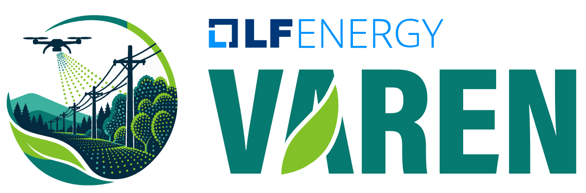

<p align="center">
  
  <br/>
</p>
<p align="center" style="font-size: 25px;">
    <b>Varen</b>
</p>

```gfm
# TODO : insert project logo - replace the below logo location with the location of your logo

```

```gfm
# TODO : Add badges that point to your LICENSE, CII status, and build environment (if it exists). Check out other badges to add at https://shields.io/

[](https://bestpractices.coreinfrastructure.org/projects/CII ID)
```

# VAREN : Vegetation and Asset Recognition of Electrical Network

## Mission Statement
The VAREN (Vegetation and Asset Recognition of Electrical Network) project is designed to democratize mobile LiDAR–based analytics for overhead electrical distribution networks by providing openly accessible algorithms capable of automatically detecting, modeling, and classifying power distribution assets as well as surrounding vegetation. The objectives of the project are to enhance grid reliability, enable the development of high‑fidelity digital twins, and accelerate data‑driven decision making within utilities through open, collaborative, and interoperable analytical solutions.

## Description
VAREN is an open source library designed to extract actionable intelligence from LiDAR point clouds for the distribution networks. It includes four main algorithms:

- MED-ALGo : Power line overhead span extractor from classified point cloud
- Mobile point cloud classifier for Power Network Assets
- Highly obstructed power line modelling using mathematical reconstruction
- Vegetation encroachment detection

>  These modules address the challenge of incomplete or obstructed mobile LiDAR data by combining geometric modeling, AI algorithms and contextual information. VAREN enables utilities to build accurate digital twins, improve asset mapping, and enhance vegetation management risk assessment.

## Project structure

```
powerlinedetection--opensource/
├── .gitignore              # Git ignore rules
├── pyproject.toml          # Build configuration & dependencies
├── LICENSE                 # Mozilla Public License 2.0
├── README.md               # This file
├── requirements.txt        # Pip requirements
├── requirements-pinned.txt # Pinned dependency versions (CI / reproducible installs)
├── venv/                   # Virtual environment (created locally)
│   ├── bin/                # (on Linux/macOS)
│   ├── Scripts/            # (on Windows)
│   ├── lib/
│   └── ...
├── input/                  # Place your .las/.laz files here
├── output/                 # Pipeline results are written here (self created)
├── src/
│   └── med_algo/
│       ├── __init__.py     # Public API exports
│       ├── pipeline.py     # Main pipeline (run_pipeline, process_las)
│       ├── constants.py    # Tunable parameters
│       ├── clustering.py   # HDBSCAN clustering
│       ├── filtering.py    # Short / perpendicular candidate removal
│       ├── fitting.py      # Robust polynomial fitting
│       ├── geometry.py     # Geometric utilities
│       ├── io.py           # LAS read/write & reprojection
│       ├── parabola.py     # Parabola generation & cluster merging
│       ├── utils.py        # Timing helpers
│       ├── Process_Results.py # Batch run + CSV report / GT validation
│       └── README.md       # README specific to MED-ALGo
└── tests/
    ├── __init__.py
    ├── test_Performance.py
    └── med_algo/
        ├── __init__.py
        ├── test_clustering.py
        ├── test_filtering.py
        ├── test_fitting.py
        ├── test_geometry.py
        ├── test_parabola.py
        └── test_security.py
```

# Prerequisites

Before installing Varen, ensure you have:

- **Python 3.9 or higher** — [Download from python.org](https://www.python.org/downloads/)
- **pip** — Usually installed with Python
- **git** — [Download from git-scm.com](https://git-scm.com/)

### Verify Installation

```bash
python --version      # Should show 3.9 or higher
pip --version         # Should show pip X.X.X
```
Note: On macOS/Linux, if python is not found, use python -m venv venv instead.

---

# Installation

### Quick Start (Recommended)

Follow these steps to set up the project in an isolated virtual environment:

#### 1. Clone the repository

```bash
## git clone https://github.com/varen-project/varen.git

## This is the internal git clone repository. Next step is to switch for LFE 
git clone https://git.hydro.qc.ca/scm/xod-i/powerlinedetection--opensource.git
cd powerlinedetection--opensource
```

#### 2. Create a virtual environment
This creates a virtual environment using the same Python version as your system Python. The virtual environment will be completely isolated from your system packages. 

```bash
python -m venv venv
```

#### 3. Activate the virtual environment

```bash
# **Linux / macOS:**
source venv/bin/activate

#**Windows (PowerShell):**
venv\Scripts\Activate.ps1

#**Windows (Command Prompt):**
venv\Scripts\activate.bat
```

#### 4. Upgrade pip (recommended)

```bash
python -m pip install --upgrade pip
```
This ensures compatibility with `pyproject.toml` and modern dependency resolution.

#### 5. Install the package with development tools

**Option A — Standard install** (end users & contributors)

```bash
pip install -e ".[dev]"
```

Installs the latest compatible versions of all runtime dependencies (numpy, pandas, laspy, scipy, scikit-learn, pyproj), testing tools (pytest, pytest-cov), and the package itself in editable mode. Changes to source code are immediately reflected without reinstalling.

**Option B — Reproducible install** (CI pipelines & bug reproduction)

```bash
pip install -r requirements-pinned.txt
pip install -e ".[dev]" --no-deps
```

Installs exact dependency versions from the pinned snapshot before installing the package. Use this when you need a byte-for-byte identical environment to CI or to reproduce a reported issue. The `--no-deps` flag prevents pip from overwriting the pinned versions.

Both options create the `med-algo` command-line tool.

#### 6. Verify installation testing the MED-AlGo

```bash
# Check if the CLI is available
med-algo --help

# Run the test suite
python -m pytest tests/ -v
```

All tests should pass. If you see a message like `PASSED` for all tests, you're ready to use MED-ALGo!

### Deactivate the virtual environment

When you're done working:

```bash
deactivate
```

### Clean up (optional)

To remove the virtual environment and all installed packages:

```bash
# **Linux / macOS / Windows (PowerShell):**
rm -rf venv

#**Windows (Command Prompt):**
rmdir /s venv
```

# License

This project is licensed under the **Mozilla Public License 2.0 (MPL-2.0)**.

## What this means:
- **You can use this software** for any purpose (commercial or personal)
- **You can modify this software**, but modifications must be shared under the same license
- **You must distribute the source code** if you distribute the software
- **You must include the license** and disclose changes
- **Patent claims** are implicitly granted by contributors

See the [LICENSE](./LICENSE) file for the full text of the Mozilla Public License 2.0.

# Release Information

Release history and notable changes are documented in [CHANGELOG.md](CHANGELOG.md), following the [Keep a Changelog](https://keepachangelog.com/) format. See also the repository's GitHub 'Releases' page once published, and [RELEASE.md](RELEASE.md) for the release process.

# Contributing

We welcome contributions! To contribute:

1. **Fork** the repository
2. **Create a branch** for your feature or bugfix
3. **Ensure all tests pass**: `python -m pytest tests/ -v`
4. **Submit a Pull Request** with a clear description of your changes

All contributions must comply with the MPL-2.0 license. See [CONTRIBUTING.md](CONTRIBUTING.md) for the full contribution process, roles, and coding style guidelines.

## Governance
PROJECT NAME is a project hosted by the [LF Energy Foundation](https://lfenergy.org). This project's technical charter is located in [CHARTER.md](tsc/CHARTER.md) and has established it's own processes for managing day-to-day processes in the project at [GOVERNANCE.md](GOVERNANCE.md).

## Meetings

TSC meeting schedule and joining instructions are documented in [GOVERNANCE.md](GOVERNANCE.md#tsc-meetings). Meeting agendas are tracked as GitHub issues, and past meeting notes are archived under [tsc/meetings](tsc/meetings).

## Discussion / Support

You can connect with the community in a variety of ways — see [SUPPORT.md](SUPPORT.md) for the full list of options, including how to ask for help and how to reach the project leads.

```gfm
TODO : Once VAREN is created, place valid urls.
- [LINK TO MAILING LIST](https://lists.lfenergy.org/g/varen-discussion)
- [#VAREN channel on LF Energy Slack](https://slack.lfenergy.org)
```

## Reporting Issues
To report a problem, you can open an [issue](https://github.com/varen-project/issues) in repository against a specific workflow. If the issue is sensitive in nature or a security related issue, please do not report in the issue tracker but instead follow the private disclosure process described in [SECURITY.md](SECURITY.md).

```gfm
TODO : Once VAREN is created, place valid urls.
- [issue](https://github.com/varen-project/issues)
```

## Acknowledgments

See [CONTRIBUTORS.md](CONTRIBUTORS.md) for the list of initial contributing organizations and persons.